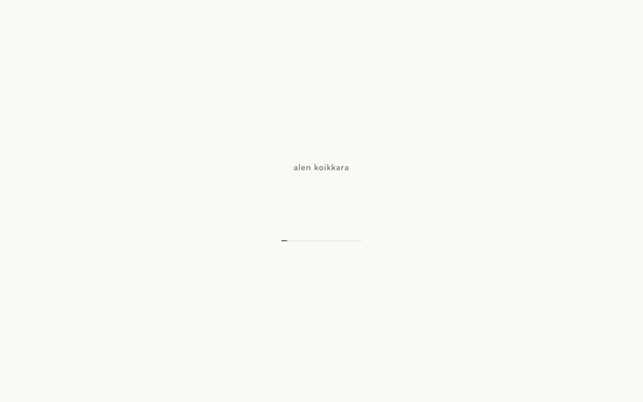

# HiChord — a portfolio you play like an instrument



**[portfolio.alenkoikkara.com](https://portfolio.alenkoikkara.com/)**

The portfolio of Alen Koikkara, a software engineer in Chicago, built as one
3D object: a Game Boy-sized macro pad called the HiChord. Each key is a
section. **Projects** opens a carousel of cartridges, and one slotted into the
device is thrown up on the desk by its projector. **Photography** hangs a wall
of prints. **About** frosts the scene behind glass and draws a career as a real
constellation. **Writing** and **Contact** open panels beside the device.

The whole site is one day in Chicago told through light: every section is an
hour, so the sun moves, the shadow swings and the clock in the corner spins
forward as you go.

## Stack

React 19 · Three.js through React Three Fiber and drei · zustand · Web Audio
(every sound synthesised, no audio files) · Tailwind · Vite · Vitest · oxlint.
Hosted on Cloudflare.

## A few things worth a look

- **The device never moves.** Every "slide" is the camera changing pose, eased
  as a direction and a distance so it can turn from three-quarter to almost
  overhead without the roll flipping.
- **Liquid Glass in WebGL.** The about view's pane and the photography hints
  refract the scene behind them in a shader, because CSS `backdrop-filter`
  can only blur.
- **Interactive within seconds.** A static loader paints from the HTML
  before any script runs; each key takes clicks the moment its own intro
  animation lands, read from the model's keyframes.
- **The wall loads only what you are looking at**: thumbnails queued from the
  middle of the view out, paused while panning fast, and reference-counted out
  of memory again.
- **Built for thumbs too**: a steeper camera and invisible hit areas of at
  least 44 px on every key on a phone.

## Run it

```bash
npm install
npm run dev        # http://localhost:5173
npm run ci         # lint, tests with coverage, build
```

The design notes — why things are the way they are, and what has been tried
and measured — live in [CLAUDE.md](CLAUDE.md).
